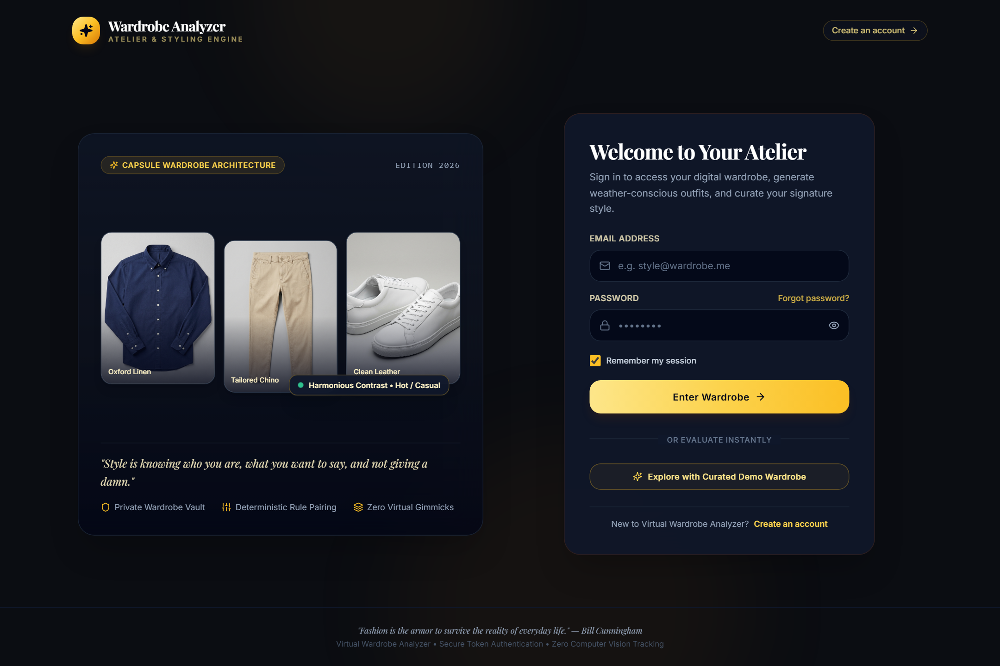
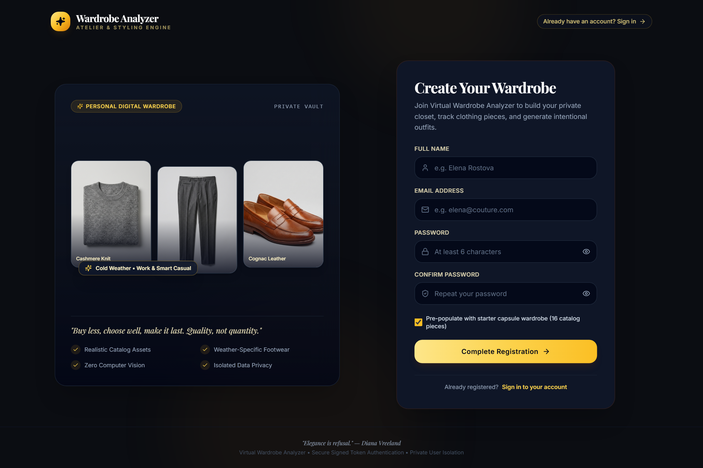
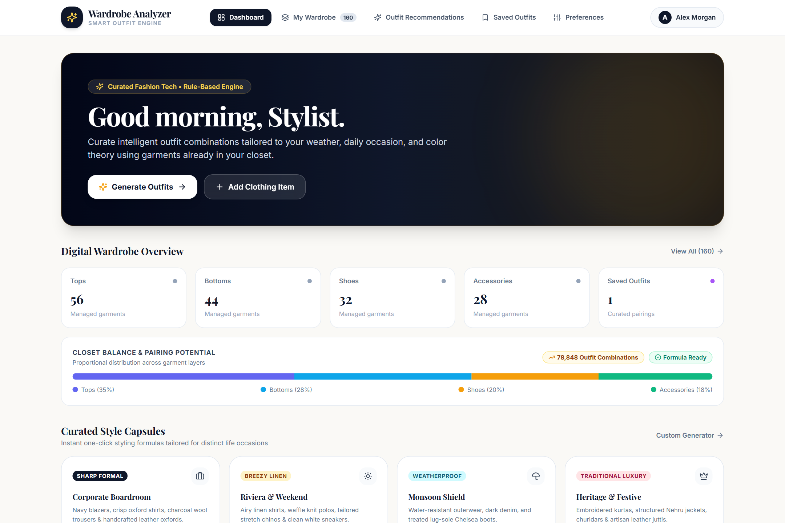
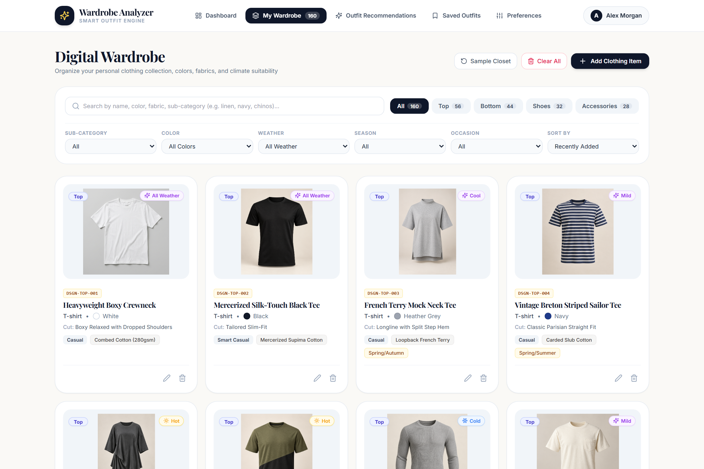
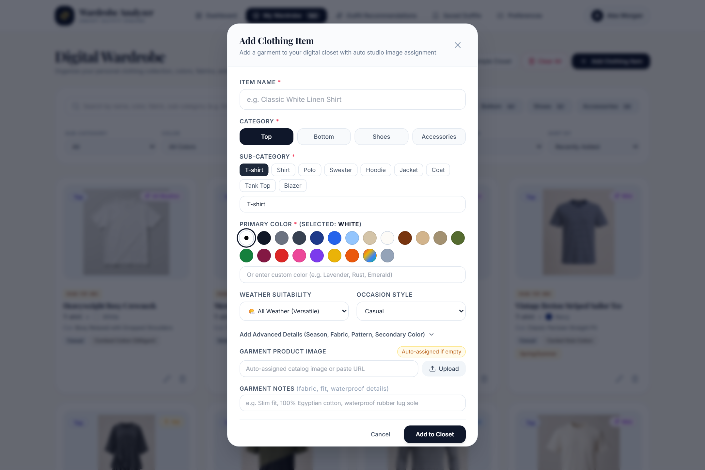
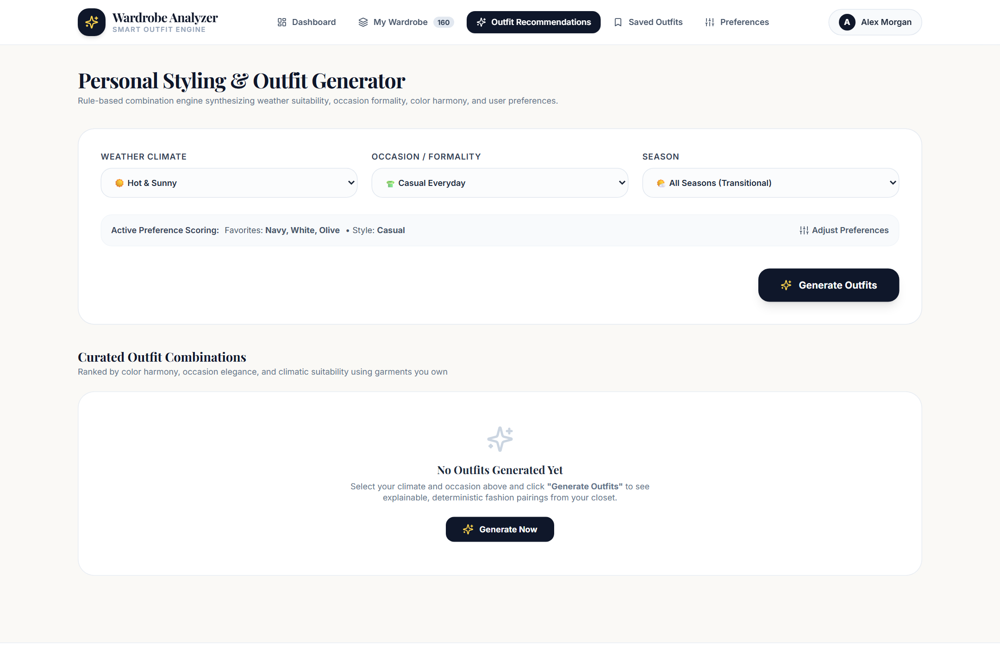
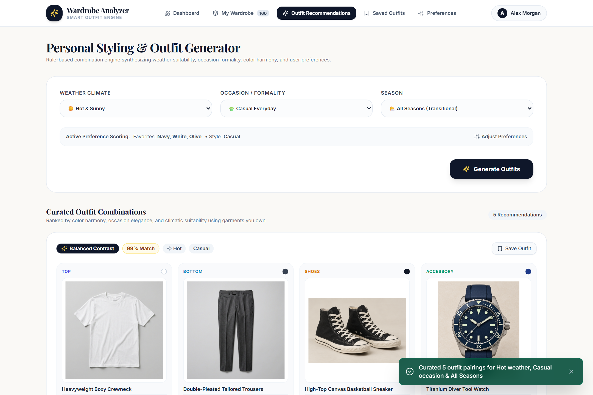
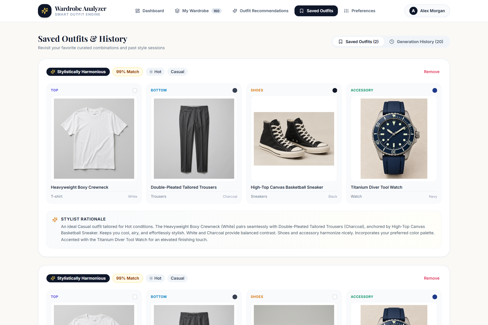
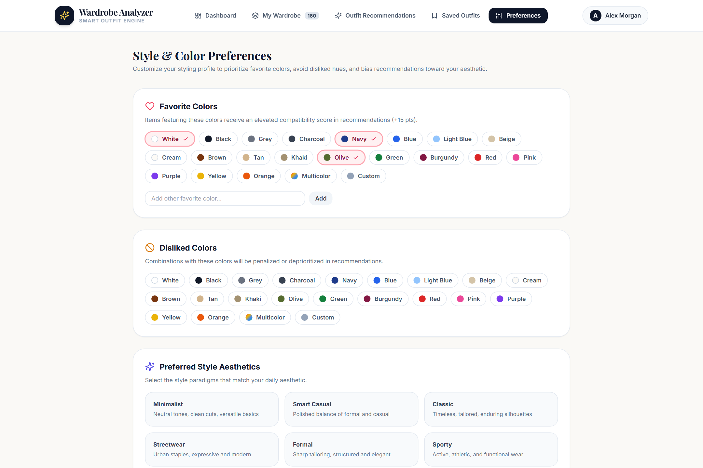

# Virtual Wardrobe Analyzer — Visual Portfolio & UI Walkthrough

A visual catalog of every page, modal, and styling view in the **Virtual Wardrobe Analyzer** web application.

---

## Interactive Visual Carousel

````carousel

<!-- slide -->

<!-- slide -->

<!-- slide -->

<!-- slide -->

<!-- slide -->

<!-- slide -->

<!-- slide -->

<!-- slide -->

````

---

## 1. Authentication Pages

### 1.1 Login Page
- **Route:** `/login`
- **Features:** Dark luxury atelier theme with warm amber/gold accents, floating badge with client testimonials, credential inputs, "Remember me" persistence, and instant demo access.


---

### 1.2 Registration Page
- **Route:** `/register`
- **Features:** Account registration, real-time password strength and match verification, option to preload the 144-piece starter capsule collection, and luxury benefits callout.


---

## 2. Main Dashboard & Wardrobe Analytics

### 2.1 Executive Dashboard
- **Route:** `/`
- **Features:** 
  - Dynamic wardrobe statistics (144 items across Tops, Bottoms, Footwear, Accessories).
  - Closet balance gauge showing formula calculation: $40 \times 32 \times 28 \times 44 = 1,576,960$ mathematical combinations.
  - Quick action shortcuts to generate outfits, add clothing, or tune preferences.
  - Curated Style Capsules (Smart Casual, Business Formal, Summer Resort, Winter Layering).


---

## 3. Digital Wardrobe & Garment Management

### 3.1 Digital Wardrobe Grid
- **Route:** `/wardrobe`
- **Features:**
  - Multi-attribute filter bar: category pills, occasion dropdown, weather compatibility, color swatches.
  - High-resolution garment catalog cards displaying realistic studio product photos.
  - Color badge pills, subcategory tagging, edit, and delete controls.


---

### 3.2 Add & Edit Garment Modal
- **Trigger:** "Add Clothing Item" on `/wardrobe`
- **Features:**
  - Dynamic subcategory selector chips (T-shirts, Oxford Shirts, Trousers, Loafers, etc.).
  - 14-shade visual color swatch palette with auto-hex matching.
  - Multi-select occasion tags and weather suitability pills.
  - Automatic intelligent image assignment based on garment parameters.


---

## 4. Rule-Based Outfit Recommendation Engine

### 4.1 Recommendation Controls & Context Filters
- **Route:** `/recommendations` (Initial State)
- **Features:**
  - Climate selector: Hot, Mild, Cool, Cold, Rainy.
  - Occasion selector: Casual, Smart Casual, Business Formal, Evening, Weekend Loungewear.
  - Season override and personal style preference weights.
  - "Curate Outfits" trigger.


---

### 4.2 Generated Outfit Recommendations
- **Route:** `/recommendations` (Results State)
- **Features:**
  - 4-piece coordinated looks (Top + Bottom + Shoes + Accessory).
  - Compatibility match score (e.g. 99% Atelier Match).
  - Editorial styling rationale explaining color harmony, fabric weight, and silhouette balance.
  - One-click "Save Outfit" bookmarking.


---

## 5. Lookbook & History

### 5.1 Saved Outfits & Curation History
- **Route:** `/saved-outfits`
- **Features:**
  - Collection of bookmarked outfit ensembles.
  - Contextual tags (Weather, Occasion, Match Score).
  - Complete garment breakdown cards.
  - Session generation history log table with timestamped queries.


---

## 6. Personal Style & Color Theory Preferences

### 6.1 Style Preferences Configuration
- **Route:** `/preferences`
- **Features:**
  - Favorite Colors palette (boosts recommendation scores).
  - Disliked Colors filter (penalizes or suppresses unwanted hues).
  - Preferred Aesthetic paradigm selection (Minimalist, Classic, Streetwear, Old Money, Bohemian).
  - Default occasion and weather preferences.


---

## Summary Table

| Page / View | URL Route | Core Purpose |
|---|---|---|
| **01. Login** | `/login` | Atelier authentication with demo quick-login |
| **02. Register** | `/register` | Secure registration with optional capsule seeding |
| **03. Dashboard** | `/` | Closet metrics, capsule collections & balance formula |
| **04. Wardrobe** | `/wardrobe` | 144-garment digital closet with multi-attribute filtering |
| **05. Add Item Modal** | `/wardrobe` | Add/edit modal with swatch palette & auto-image assignment |
| **06. Recommendation Filters** | `/recommendations` | Weather & occasion filters with style weights |
| **07. Outfit Results** | `/recommendations` | Rule-based 4-piece outfits with match scores & styling notes |
| **08. Saved Outfits** | `/saved-outfits` | Bookmarked looks & chronological styling log |
| **09. Preferences** | `/preferences` | Color harmonies, dislikes, and aesthetic presets |
